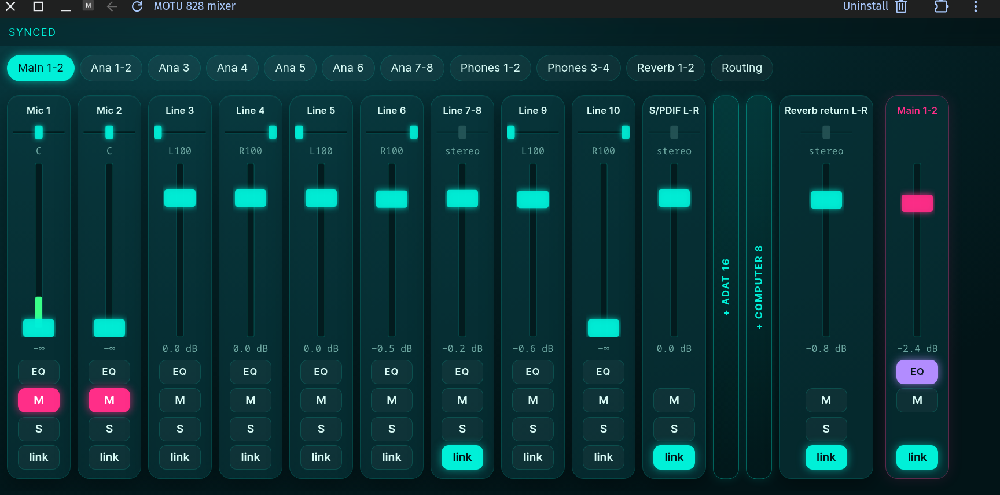

# MOTU 828 Mixer for Linux

A web-based mixer for the **MOTU 828** (the 2023/2024 USB-C model) on Linux, without CueMix. A small Python service
owns the 828's control port and serves one page on your LAN, so you can mix from any browser: desktop, phone or tablet.



MOTU's CueMix 5 runs only on macOS, Windows and iOS, and the unofficial Linux build from 2024 was never updated. The
828's control protocol was recovered from CueMix's own (readable) JavaScript and checked against a real unit. It is
documented in [PROTOCOL-SPEC.md](PROTOCOL-SPEC.md). The design contract the first version was built against is
in [docs/delivery-contract.md](docs/delivery-contract.md).

> **Not affiliated with or endorsed by MOTU.** Verified only on 828 firmware **1.1.8 (datastore API 9)**. On any
> other model or API version the service runs **read-only** and says why.

## Features

- **CueMix-style mixer:** a tab per mix bus, one strip per input (fader, pan, mute, solo, stereo link), bus masters.
  The unit's state is mirrored live, including changes made on the front panel or by another client.
- **Live meters** in each fader track (the 828's own peak meters, about 17 updates a second).
- **Input EQ** (Mic 1-2, Line 3-10, 4 bands) and **bus EQ** (Main, Ana 1-8, Phones, Reverb, 3 bands): a
  response curve with draggable band points, plus mode, frequency, gain and Q per band.
- **Routing:** any source to any output, including **direct input → output routes** (for example Line 7-8 straight
  to S/PDIF out) without using up a mix bus.
- Double-click a fader or master to set 0 dB, or a pan to centre it.
- Any browser on your network; no login, no build step.

## Safety

- **Never writes** phantom power (48V), preamp gain, pad or output trim. Writes are limited to an allowlist of
  mixer, routing and EQ properties, and EQ values outside CueMix's ranges are refused rather than clamped.
- **S/PDIF feedback guard:** any change that would carry S/PDIF in to S/PDIF out is refused, directly or through a
  mix or the reverb. This protects setups such as a modeller connected over S/PDIF in both directions.
- **Read-only** on an unverified model or protocol version.

## Requirements

- Linux with ALSA; the 828 connected by USB. It is class-compliant, so no driver is needed.
- Python ≥ 3.14, [`uv`](https://docs.astral.sh/uv/), `amidi` (from alsa-utils) and `libasound`.
- Node.js only to run the page's tests.

## Install

```sh
git clone https://github.com/esazhin/motu-828-mixer.git && cd motu-828-mixer
uv venv .venv
uv pip install -e '.[dev]'
source .venv/bin/activate                 # fish: source .venv/bin/activate.fish
cp config.local.example config.local      # optional: your machine's settings (git-ignored)
```

Your user needs access to `/dev/snd/midiC*`; desktop sessions grant it through logind. Check that `amidi -l` lists
a port named `828 COM`.

## Run

```sh
python -m _motu_mixer
```

Open `http://<this-machine>:8280` from any device on the LAN (or `http://localhost:8280`). The status line reads
`syncing` while the 828 sends its full state, then `synced`. Other states: `no 828 connected`, `no 828 answered`,
`control port busy`, `disconnected`, `released`, and `Read-only: …`.

Direct links: `/#routing` opens the Routing tab; `/#eq:out:0` opens the Main EQ.

**As a desktop app:** in Chrome, open the page and choose *Cast, save and share → Create shortcut… → Open as window*.

## Configuration: `config.local`

Machine-specific settings go in `config.local` (git-ignored), as plain `KEY=VALUE` lines. The service, the launcher
script and the systemd unit all read it, and real environment variables override it. See
[config.local.example](config.local.example).

| variable | default | meaning |
|---|---|---|
| `MOTU_PORT_NAME` | `828 COM` | rawmidi port name as `amidi -l` lists it (matched exactly, never a card number) |
| `MOTU_HTTP_HOST` | `0.0.0.0` | address to listen on |
| `MOTU_HTTP_PORT` | `8280` | HTTP + WebSocket port |
| `MOTU_OPEN_URL` | `http://localhost:$MOTU_HTTP_PORT/` | the URL the launcher opens |
| `MOTU_CONFIG` | `<repo>/config.local` | an alternative config file |

A one-off override from the shell: `MOTU_HTTP_PORT=5058 python -m _motu_mixer`. An invalid port makes the service
exit with a non-zero code.

## Launcher, desktop icon and dock

`scripts/motu-mixer-start` starts the service if it isn't running (through the systemd user unit if installed,
otherwise in the background, logging to `~/.local/state/motu-mixer/`), waits for the unit to sync, then opens the
browser. If something goes wrong it shows a desktop notification.

```sh
ln -s "$PWD/scripts/motu-mixer-start" ~/.local/bin/motu-mixer-start
cp deploy/motu-mixer.desktop ~/.local/share/applications/        # app menu / dock
cp deploy/motu-mixer.desktop ~/Desktop/ && chmod +x ~/Desktop/motu-mixer.desktop   # desktop icon (mark it trusted)
```

## Start with your login (systemd user unit)

```sh
mkdir -p ~/.config/systemd/user
sed "s|<repo>|$PWD|g" deploy/motu-mixer.service > ~/.config/systemd/user/motu-mixer.service
systemctl --user daemon-reload && systemctl --user enable --now motu-mixer
```

The unit runs `.venv/bin/python -m _motu_mixer` from the repository, reads `config.local`, and restarts 2 s after a
failure. Check it with `systemctl --user status motu-mixer` and `journalctl --user -u motu-mixer -f`.

## Hand the port over to CueMix or the tools

Only one program can hold `828 COM` at a time:

```sh
curl -X POST http://localhost:8280/api/port/release    # {"status": "released"}; the port is free within 1 s
# ... run the other program, then quit it ...
curl -X POST http://localhost:8280/api/port/acquire    # the service takes it back and resyncs
```

`GET /api/diag/sent?n=50` lists the last messages sent to the unit.

## Tools

- `tools/motu828_read.py --live`: read-only dump of the unit's identity and routing (`--dump <file>` offline).
- `tools/motu828_w1.py`: the first write check (one unused fader cell: write, read back, restore).
- `tools/asar_extract.py`: unpacks an Electron `app.asar`, to read CueMix's JavaScript yourself.

## Tests

```sh
python -m pytest                                  # hermetic: no 828, no network; replays fixtures/
node --test _motu_mixer/presentation/static/      # the page's JavaScript
MOTU_LIVE=1 python -m pytest -m live              # live checks against an attached 828
```

The live checks need the service stopped or the port released. They write only a few unused, inaudible cells (an
ADAT B 8 → Reverb 1 fader and mute, the Reverb 2 master, Line out 10's routing) and restore each afterwards, even
when interrupted. `fixtures/` holds a real capture of a 828's full state; its serial number and MAC are replaced
with placeholders.

## Credits

Licensed under the [Apache License 2.0](LICENSE). The protocol knowledge, the property and meter index tables, and
the EQ response math (`eq_math.js`) derive from MOTU's CueMix 5 JavaScript, which is also Apache-2.0; see
[NOTICE](NOTICE).
